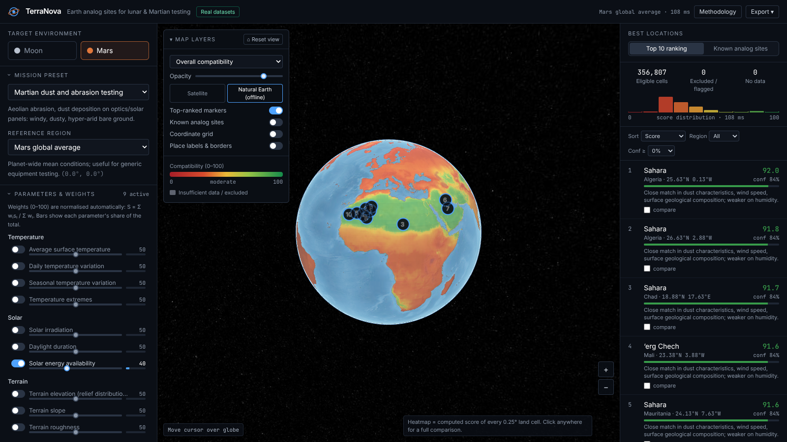

# TerraNova — Earth analog sites for lunar & Martian testing

**NASA Space Apps Challenge 2026 · Permanent Moon Base Locations and Mars**

TerraNova ranks every land cell on Earth (0.25° grid, ~357,000 cells) by how well it reproduces a
**specific, user-chosen set of lunar or Martian conditions** for a given test campaign: rover
mobility, landing-site simulation, habitat analogs, dust/abrasion tests, solar-power testing, and so on.
It is not a "looks like Mars" map. Every score is computed from real Earth observation data and compared
against published planetary measurements, and the app says how complete and reliable each score is.



---

## 1. Quick start

Requirements: Python ≥ 3.10, Node ≥ 18.

```bash
./run.sh
```

Then open http://localhost:8000. The script creates `.venv`, installs the backend, builds the frontend,
and serves everything from FastAPI.

### Development (hot reload)

```bash
python3 -m venv .venv && . .venv/bin/activate
pip install -r backend/requirements.txt
cd backend && uvicorn app.main:app --reload --port 8000
```

```bash
cd frontend && npm install && npm run dev
```

The Vite dev server runs on http://localhost:5173 and proxies `/api` to port 8000.

### Tests

```bash
cd backend && pytest -q
```

```bash
cd backend && TERRANOVA_DEMO=1 pytest -q
```

The first command runs against the real grid. The second runs the same suite on synthetic demo data.

### Rebuilding the data grid (optional)

The processed grid is committed under `data/processed/` (~36 MB), so the app works out of the box.
To regenerate it from the original sources (~600 MB download, ~3 min on a fast link):

```bash
python backend/scripts/build_grid.py
```

You can also rebuild only some stages: `python backend/scripts/build_grid.py power dem landcover vector`.

---

## 2. What the app does

| Area | Features |
|---|---|
| **Configuration (left)** | Moon / Mars target; 10 mission presets; 8 reference regions (Mare, Highlands, Lunar south pole, Mars global, Gale, Jezero, Utopia, Meridiani, Elysium); 25 parameters, each with an on/off switch, a 0–100 weight, a weight-share bar, an explanation, its data quality, reproducibility class, source and editable tolerance σ; hard constraints with exclude or flag modes; missing-data policy (score + confidence, or exclude); saved configurations (browser) plus JSON import. |
| **3D globe (centre)** | CesiumJS globe with satellite imagery (Esri), falling back to offline Natural Earth II. Real computed heatmap (red → yellow → green, grey = insufficient data or excluded) that cross-fades when parameters change. Layer modes: overall compatibility, data confidence, constraint failures, per-category compatibility, any single-parameter similarity, and 15 raw Earth data layers. Ranked markers, known analog sites, coordinate grid, place labels and borders, live cursor coordinates, zoom and reset. Click anywhere to analyse that cell. |
| **Results (right)** | Top 10 with score, confidence, coordinates, country, a data-driven reason and constraint warnings; sort and filter; score histogram; side-by-side comparison of up to 6 sites (radar + table); a **validation tab** showing where NASA/ESA field-analog sites fall in the score distribution. |
| **Location analysis** | Comparison table (target · Earth · difference · similarity · reproducibility · source · data-quality badges); an explanation built from the measured values; category scores; climate charts (monthly temperature, diurnal range, solar irradiation vs. TOA, daylight, precipitation, wind) against target values; terrain slope distribution (Earth 2.4 km, Earth 150 m live, target); a live elevation histogram (AWS Terrain Tiles z10); live NASA POWER and ISRIC SoilGrids lookups; sources and limitations. |
| **Export** | Ranked list as CSV · locations as GeoJSON · configuration as JSON · per-location PDF report. |

### Research assistance features

| Feature | Where | How it works |
|---|---|---|
| **Research advisor** (post-research advice & input filtering) | Right panel → *Advisor* tab, offered as soon as an analysis finishes | `backend/app/advisor.py` reviews every parameter the user entered: weight share, data coverage, data quality, reproducibility, how much it separates candidate sites, how well the top sites match it, and whether removing it changes the #1 site (leave-one-out). Each gets a verdict (*Relevant / Needs review / Reduce weight / Lab only / Not relevant / Consider adding*) with the numeric reason and one-click actions (disable, halve weight, enable). Constraints are reviewed too: share of land each one removes. Practical advice for conducting the study is generated from the same numbers. |
| **Experiment search** | Location window → *Overview* | `frontend/src/components/ExperimentSearch.tsx`: an in-browser BM25 search engine over everything known about the location (comparison rows, parameter definitions, explanation, execution plan, NASA verification, limitations, data-derived FAQ). Works offline. With Claude configured, *Ask AI* answers the same question from TerraNova's data. |
| **Experiment execution & climate readjustment** | Location window → *Execution* | `backend/app/execution.py`: climate match per month from NASA POWER monthly climatology, best 3-month testing window, gaps with concrete mitigations, step-by-step execution plan, and machine-applicable readjustments (score climate for a test season, widen tolerances that no Earth site can meet, disable lab-only conditions). A season picker and climate weight/tolerance editor re-run the whole analysis. |
| **NASA data verification** | Location window → *NASA verification*; automatic for the top 3 sites (badge on each result card) | `backend/app/verify.py`: compares the climate values used for scoring with NASA's official POWER records for the same grid cell, first through the **NASA POWER API** (power.larc.nasa.gov), then through **NASA POWER Analysis-Ready Data on AWS** (s3://nasa-power), with explicit tolerances per variable (temperature, irradiance, clearness index, wind, precipitation, humidity, pressure, 12 monthly temperatures). |
| **PDF report** | Location window → *PDF report* | `frontend/src/lib/pdfReport.ts` (jsPDF + jspdf-autotable): cover band with score badge, key-figure cards, summary, category bars, drawn monthly temperature chart, comparison table grouped by category with similarity bars, execution plan, NASA verification table, sources, method, limitations, running header and page numbers. |
| **Languages** | Header → language menu | `frontend/src/i18n/`: English, עברית (right-to-left), Español, Français for the whole interface (330 strings, generated from `frontend/scripts/translations.py`). Scientific content produced by the backend (parameter descriptions, explanations, citations) stays in English so units and terminology stay exact; the PDF is English because the built-in PDF fonts are Latin-only. Claude answers in the selected language. |

---

## 3. Scientific method

For each land cell *x*:

```
S(x) = Σ wᵢ · sᵢ(x) / Σ wᵢ                  compatibility, 0–100 (enabled params with data)
C(x) = Σ_available wᵢ · qᵢ / Σ_enabled wᵢ   data confidence, 0–100
```

* **wᵢ** are the user's weights. They are normalised automatically.
* **sᵢ** are similarity functions matched to each parameter:
  * **Gaussian** `exp(−(x−t)²/2σ²)` for temperature, irradiance, clearness index, AOD, wind, precipitation, humidity, aridity and soil wetness.
  * **Log-Gaussian** for scale quantities (elevation spread, roughness, pressure).
  * **Bhattacharyya overlap** between the Earth's 9-bin slope histogram and a log-normal target slope distribution built from published median and p90 values. The whole distribution is compared, not just the mean.
  * **Paired Gaussians** for temperature extremes (both min and max must match) and daylight (shortest and longest month).
  * **Preference functions** for logistics (road distance, accessible or remote mode; protected areas).
* **qᵢ** is a data-quality factor: measured/satellite 1.0, reanalysis 0.9, modelled from data 0.7, proxy 0.4.
* **Missing data are never scored as zero.** They are skipped and lower *C(x)*. In "exclude" mode those cells turn grey instead.
* **Hard constraints** are evaluated independently of *S*: max slope p90, min irradiance, max daily or seasonal temperature range, max elevation variation, min contiguous area (8-connected components of passing cells above a score threshold), max road distance, protected areas, and ice sheets. A violating cell is excluded or flagged, so it can never rank highly by accident. If a constraint value is unknown, the cell counts as violating it (conservative).
* **Ranking** takes the highest-scoring eligible cells with greedy non-maximum suppression (default minimum separation 250 km), so the top 10 are distinct regions.
* **Performance.** Per-parameter similarity vectors are cached, so moving a weight slider only redoes the weighted sum over the land cells. Responses take 15–60 ms. The first computation of a new tolerance or target takes ~150 ms.

### Reproducibility classes

Each parameter is labelled **directly reproducible** (terrain, slope, aridity…), **partially reproducible** (temperature, solar, dust, wind…), **laboratory only** (vacuum or Martian pressure, space radiation) or **not reproducible** (sustained reduced gravity).
The last two groups are shown with real Earth values but are disabled by default. If enabled, they push every site towards 0 by construction rather than producing misleading high scores.

### Validation

The "Known analog sites" tab scores 16 established field-analog sites (Atacama, Devon Island/HMP, MDRS, HI-SEAS, McMurdo Dry Valleys, Rio Tinto, Svalbard AMASE, Teide, Meteor Crater, Black Point Lava Flow, Lanzarote PANGAEA, Askja, Ries, Concordia, …).
These sites are **not used as inputs**. Examples with the presets:

* Atacama ranks first for *Lunar landing* and *Lunar rover*.
* The Sahara ranks first for *Mars landing* and *Mars dust*.
* Askja (Iceland) sits at the 97th percentile and the Dry Valleys at the 99th for *Lunar polar base*.

---

## 4. Datasets actually integrated (real data)

| Dataset | Provider / access | Used for | Resolution · period |
|---|---|---|---|
| **NASA POWER v10 – MERRA-2 climatology** | NASA LaRC, Analysis-Ready Zarr on AWS Open Data `s3://nasa-power/merra2/…climatology…zarr` | 2 m and skin temperature (mean, diurnal range, extremes, monthly), wind, precipitation, specific humidity, soil wetness, snow fraction, surface pressure | 0.5° × 0.625° · 2001–2020 |
| **NASA POWER v10 – CERES SYN1deg climatology** | NASA LaRC, AWS `s3://nasa-power/syn1deg/…` | All-sky and TOA irradiance (monthly), clearness index, aerosol optical depth (550 nm), day length | 1° · 2001–2020 |
| **AWS Terrain Tiles (terrarium)** | Mapzen / AWS Open Data `elevation-tiles-prod`; SRTM, GMTED2010, ETOPO1 mosaic | Elevation mean/std/min/max, km-scale slope histogram, roughness (zoom 6, ~2.4 km px); live 150 m samples (zoom 10) in the detail view | z6 aggregated to 0.25°; z10 on demand |
| **ESA WorldCover 10 m v200** | ESA / AWS Open Data `s3://esa-worldcover` (1:64 COG overview) | Bare-ground fraction, vegetation, snow/ice | ~640 m → 0.25° · 2021 |
| **Natural Earth 1:10m** | naturalearthdata.com (GitHub mirror) | Country, named geographic regions, nearest populated place, distance to roads, US protected lands | v5.1 |
| **NASA POWER point API** *(live, optional)* | power.larc.nasa.gov | Independent cross-check in the detail view | point |
| **ISRIC SoilGrids 2.0** *(live, optional)* | rest.isric.org | Sand/silt/clay, bulk density, SOC, coarse fragments (context only) | 250 m |

Derived layers (documented in code):
* Aridity index P/PET, with PET from Hargreaves–Samani (FAO-56 eq. 52).
* Seasonal temperature range.
* Daylight fraction minimum and maximum.
* Distance to water ice. Ice means WorldCover snow/ice, MERRA-2 snow fraction, or annual-maximum skin temperature below 0 °C.

**Planetary reference values** (`backend/app/scoring/targets.py`) are literature summaries, each with its citation and a quality tag:
* `measured`: reported by an instrument.
* `derived`: computed from constants.
* `estimated`: order-of-magnitude, read from published maps.

Sources: LRO Diviner and LOLA, LOLA illumination studies, Diviner rock abundance, MGS MOLA, THEMIS/TES rock abundance, MSL REMS and RAD, Mars 2020 MEDA, InSight TWINS, Viking Lander 2, MRO SHARAD, LCROSS, Chang'e-4 LND and the NASA fact sheets.

## 5. What is a proxy or demonstration

* **Demo mode.** If `data/processed/` is missing or `TERRANOVA_DEMO=1` is set, a **synthetic** analytic grid is used. A permanent amber "DEMO MODE · SYNTHETIC DATA" badge appears, and PDF reports carry the label too. With the committed data, the app runs in **real** mode and never mixes the two.
* **Proxy indices** (q = 0.4, labelled "proxy" everywhere):
  * *Rock abundance* = bare-ground fraction × km-scale roughness.
  * *Soil characteristics* = bare fraction × hyper-aridity.

  No open global rock-cover or regolith-texture grid exists for Earth, so these must not be read as measurements.
* **Estimated planetary targets.** Relief, roughness, slope distributions and some temperatures are order-of-magnitude values; the UI tags them `estimated`.

## 6. Known limitations / not yet done

* The grid is 0.25° (~28 km) and the climate inputs are coarser, so microclimates and site-scale (metre) terrain are not resolved. Slope depends on baseline: here ~2.4 km for scoring, 150 m in the detail view.
* Planetary targets are tabulated literature values, not rasters. The code is modular (`targets.py`, `parameters.py`), so PDS rasters (MOLA MEGDR, LOLA LDEM, Diviner GDR, THEMIS TI) can replace them. That ingestion is not implemented.
* No thermal-inertia comparison (THEMIS/Diviner vs. Earth) yet, and no global lithology layer (e.g. basalt fields), so "geological composition" means bare mineral surface only.
* Protected areas cover the **USA only** (Natural Earth). WDPA would be the global source; it needs a licence or an API token.
* Results and saved configurations are kept in memory and in browser `localStorage`; there is no PostGIS persistence.
* The live NASA POWER and SoilGrids lookups need outbound internet. If they are unreachable, the UI says so and falls back gracefully.

## 7. Deployment (Hugging Face Spaces)

GitHub Pages cannot host TerraNova because the scoring runs in a Python backend. The repository
contains a `Dockerfile` (frontend build + FastAPI runtime, port 7860) and a GitHub Actions workflow,
`.github/workflows/deploy-hf.yml`, that publishes the app to a Hugging Face Space on every push to `main`.

One-time setup:
1. Create a Hugging Face account and an access token with **write** permission (huggingface.co → Settings → Access Tokens).
2. In this GitHub repository: Settings → Secrets and variables → Actions:
   * add the **secret** `HF_TOKEN` with the token;
   * add the **variable** `HF_SPACE`, e.g. `your-username/terranova`. The Space is created automatically if it does not exist.
3. Push to `main` (or run the workflow manually from the Actions tab). The Space builds the Docker image, which takes a few minutes, and the app appears at `https://huggingface.co/spaces/<HF_SPACE>`.

The same `Dockerfile` works on any container host (Render, Fly.io, Cloud Run):

```bash
docker build -t terranova . && docker run -p 7860:7860 terranova
```

## 8. Configuration / API keys

No API keys are required. Claude-powered text (research brief, *Ask AI*) is optional.

| Variable | Where | Purpose |
|---|---|---|
| `VITE_CESIUM_ION_TOKEN` | `frontend/.env` | Optional Cesium ion token. Not needed: imagery is Esri (keyless) or bundled Natural Earth. |
| `VITE_API_TARGET` | dev only | Backend URL for the Vite proxy (default `http://127.0.0.1:8000`). |
| `TERRANOVA_DEMO=1` | backend | Force the synthetic demo grid. |
| `TERRANOVA_HTTP_TIMEOUT` | backend | Timeout for live connectors (s, default 12). |
| `PORT` | `run.sh` | Server port (default 8000). |
| `ANTHROPIC_API_KEY` | backend | Optional. Enables the Claude-written research brief and *Ask AI* (model `claude-opus-5-5`). Without it, all advisor, execution and search features still work from computed data. |
| `TERRANOVA_CLAUDE_MODEL` | backend | Optional override of the Claude model. |
| `TERRANOVA_DISABLE_LLM=1` | backend | Turn the Claude features off even if a key is present. |

## 9. Architecture

```
backend/
  scripts/build_grid.py     data pipeline: POWER Zarr, Terrain Tiles, WorldCover COGs, Natural Earth → data/processed
  app/main.py               FastAPI: /api/meta /api/analyze /api/layer/{id}.png /api/location /api/live /api/validation
  app/data/grid.py          loads layers onto the 0.25° grid (native-resolution nearest-neighbour for climate)
  app/data/connectors.py    live point connectors (NASA POWER, SoilGrids, Terrain Tiles z10) with disk cache
  app/data/demo.py          synthetic demo grid (clearly labelled)
  app/scoring/parameters.py parameter catalogue: layers, similarity kind, tolerance, quality, reproducibility
  app/scoring/similarity.py Gaussian, log-Gaussian, Bhattacharyya, preference functions
  app/scoring/targets.py    Moon/Mars reference regions with citations
  app/scoring/engine.py     weighted score, confidence, constraints, caching
  app/scoring/analysis.py   ranking (NMS), comparison tables, explanations
  app/scoring/presets.py    mission presets
  app/render.py             server-side PNG rendering of heatmaps
frontend/ (React + TypeScript + Vite + Tailwind + CesiumJS + Recharts + jsPDF)
  src/components/Globe.tsx, ConfigPanel.tsx, ResultsPanel.tsx, LocationDetail.tsx, CompareModal.tsx, …
data/processed/             preprocessed grids (committed); data/cache/ raw downloads (git-ignored)
```

To add a dataset:
1. Add a stage to `build_grid.py`, or a connector in `connectors.py`.
2. Expose the layer in `grid.py`.
3. Declare a `Param` in `parameters.py`.
4. Add target values in `targets.py`.
